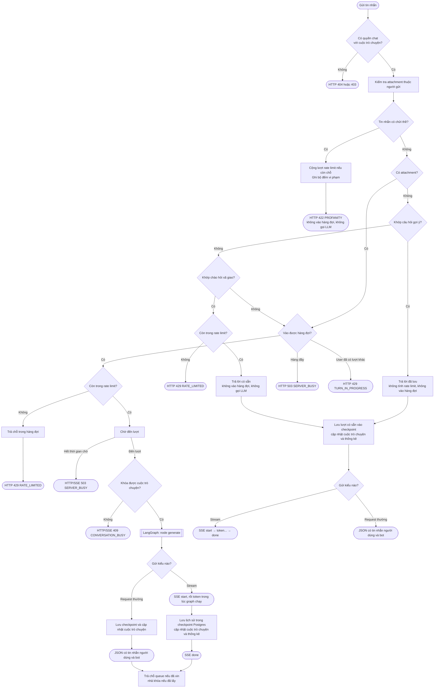
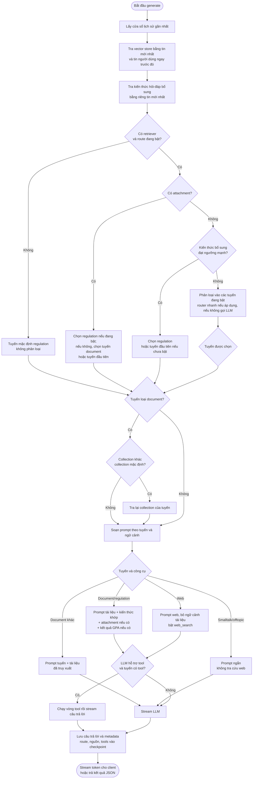

# Luồng xử lý tin nhắn chat

Tài liệu mô tả luồng gửi tin hiện tại. Code chính: `app/api/v1/conversations.py` (quyền truy cập, lọc trước, hàng đợi và stream), `app/services/chat/graph.py` (LangGraph), `app/services/chat/route_catalog.py` (cấu hình tuyến), `app/services/chat/scope.py` (phân loại), `app/services/rag/` (truy xuất tài liệu).

## 1. Từ request đến câu trả lời

Các kiểm tra quyền và attachment diễn ra trước lọc nội dung. Chửi thề luôn trả `422 PROFANITY`; lượt này chỉ được ghi vào rate limit nếu cửa sổ còn chỗ, và không bị đổi thành lỗi 429. Tin có attachment bỏ qua câu trả lời gợi ý/chào hỏi để nội dung tệp được xử lý trong graph. Câu hỏi gợi ý không tính rate limit; chào hỏi có sẵn thì có tính. Tin bình thường xin chỗ trong queue trước rồi mới tính rate limit; nếu rate limit từ chối, chỗ queue được trả ngay. Giới hạn lấy từ `CHAT_RATE_LIMIT` (mặc định `10/5m`, hỗ trợ nhiều cửa sổ hoặc `off`).

Với endpoint stream, lỗi kiểm tra trước khi stream được trả dưới dạng HTTP bình thường. Trong stream, queue có thể phát `queued`; lượt xử lý tiếp tục bằng `start`, các `token`, rồi `done`, hoặc `error` nếu lỗi. Request thường chờ queue mà không phát sự kiện vị trí. Queue và khóa cuộc trò chuyện được nhả trong mọi trường hợp.

## 2. Bên trong node `generate`

Retriever lỗi không làm hỏng lượt chat: graph tiếp tục mà không có ngữ cảnh tài liệu. Danh sách tuyến lấy từ `vector-docs/routes.json`, chỉ gồm edge đang bật và node không ở trạng thái `pending`; tuyến loại `web` bị loại khi `WEB_SEARCH_ENABLED=false`. Không có retriever thì phân loại bị bỏ qua và graph dùng prompt mặc định regulation.

Với câu hỏi nối tiếp, truy vấn tài liệu ghép hai tin người dùng gần nhất để giữ ngữ cảnh; điểm phân loại dùng riêng câu mới nhất khi có lịch sử trước đó. Nếu có kiến thức bổ sung đạt ngưỡng `KB_STRONG_SCORE`, graph ưu tiên tuyến regulation (hoặc tuyến đầu tiên nếu regulation không bật). Attachment cũng bỏ qua phân loại và chọn regulation, nếu không có thì chọn tuyến document rồi tuyến đầu tiên. Tuyến document có thể kích hoạt lần truy xuất thứ hai vào collection riêng của tuyến.

Các tuyến loại document dùng tài liệu đã truy xuất. Riêng regulation còn ghép kiến thức hỏi-đáp phù hợp, nội dung attachment và kết quả tính GPA nếu có. Tuyến web bỏ ngữ cảnh ChromaDB và bật `web_search`; tuyến smalltalk/offtopic không tìm web. Công cụ chỉ chạy khi model hỗ trợ tool calling. Lịch sử chat được checkpoint trong Postgres; nguồn, tuyến và log tool cũng được lưu trong metadata của tin bot.

## 3. Ý nghĩa các loại tuyến

| Loại tuyến | Prompt / dữ liệu | Công cụ |
|---|---|---|
| `document` | Dùng collection ChromaDB được cấu hình cho node. `regulation` dùng prompt quy chế và có thêm xử lý GPA/kiến thức bổ sung. | `calculate`, `compare_numbers` cho regulation nếu model hỗ trợ |
| `web` | Bỏ ngữ cảnh tài liệu, tìm thông tin web theo prompt tuyến | `web_search` nếu model hỗ trợ |
| `smalltalk` | Trả lời xã giao bằng LLM nếu request không được lớp API trả lời có sẵn | Không |
| `offtopic` | Từ chối lịch sự theo prompt tuyến | Không |

ID tuyến có thể được quản trị viên cấu hình; `regulation`, `external`, `offtopic`, `smalltalk` là các ID mặc định, không phải danh sách cố định của graph.

## 4. Hai lớp trả lời xã giao

- `suggested.lookup`: câu hỏi gợi ý có câu trả lời được lưu sẵn; bỏ qua rate limit, queue và LLM.
- `smalltalk.lookup`: câu chào/cảm ơn/tạm biệt thuần xã giao có câu trả lời có sẵn; tính rate limit nhưng bỏ queue và LLM.
- Nếu không khớp toàn bộ tin nhắn (hoặc có attachment), tin đi qua graph. Router có thể chọn tuyến `smalltalk`, trường hợp này vẫn gọi LLM.

Code triển khai: `app/api/v1/conversations.py`, `app/services/chat/graph.py`, `app/services/chat/route_catalog.py`, `app/services/chat/scope.py`.
