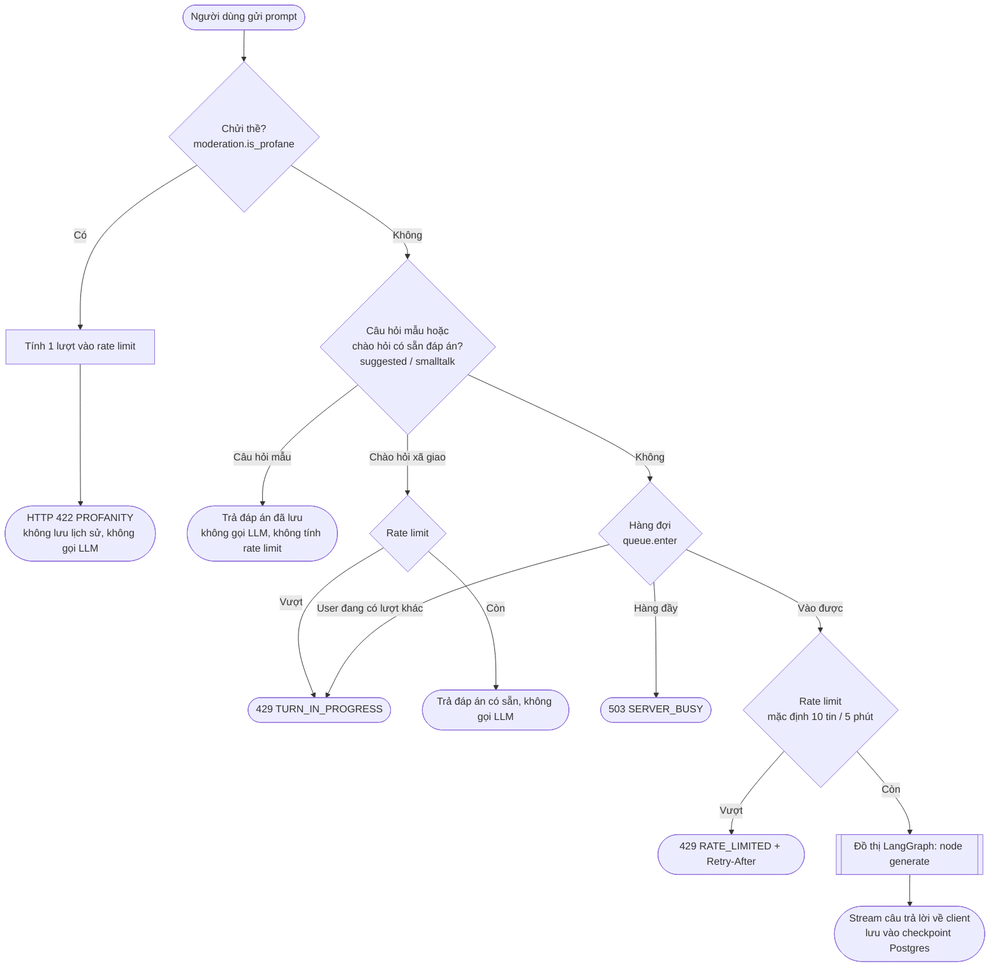
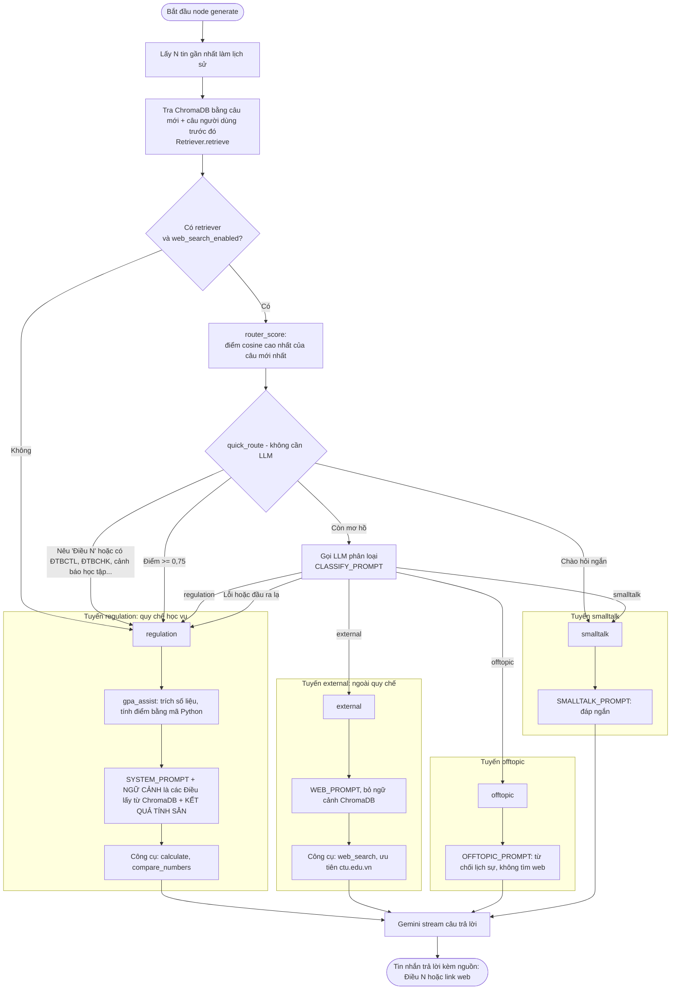

# Flow xử lý một tin nhắn của agent

Tài liệu này chỉ mô tả đường đi của một prompt từ lúc người dùng gửi cho tới lúc có câu trả lời.
Code chính: `app/api/v1/conversations.py` (lọc đầu vào, hàng đợi), `app/services/chat/graph.py` (đồ thị LangGraph),
`app/services/chat/scope.py` (router phạm vi), `app/services/rag/store.py` (ChromaDB).

## 1. Toàn cảnh

Lưu ý thứ tự: **chửi thề được kiểm tra TRƯỚC rate limit** (tin chửi vẫn bị tính vào hạn mức nhưng luôn nhận lời cảnh báo
chửi thề chứ không nhận 429). Rate limit chỉ chặn các tin còn lại, và nằm sau bước xin chỗ trong hàng đợi.

## 2. Bên trong node `generate` (router phạm vi + RAG)

Đồ thị chỉ có **một node** `generate`. Router nằm bên trong node này và chạy **sau** khi đã tra ChromaDB một lần
(vì điểm giống nhau của kết quả tra cứu là một tín hiệu để chọn tuyến).

## 3. Bảng tóm tắt các tuyến

| Tuyến | Khi nào | Dùng ChromaDB | Công cụ | Nguồn trích dẫn |
|---|---|---|---|---|
| `regulation` | Hỏi quy chế học vụ (tín chỉ, điểm, học bổng, cảnh báo học tập, tốt nghiệp...) | Có: đưa các Điều liên quan vào prompt | `calculate`, `compare_numbers` | "Điều N" |
| `external` | Về trường hoặc việc học nhưng ngoài quy chế (học phí cụ thể, lịch thi, ký túc xá, tuyển sinh...) | Không (đã tra nhưng bỏ kết quả) | `web_search` | Link web `[n]` |
| `offtopic` | Không liên quan học vụ hoặc trường | Không | Không | Không |
| `smalltalk` | Chào hỏi, cảm ơn, hỏi bot là ai | Không | Không | Không |

## 4. Những điểm cần nhớ

- **Mọi lỗi của router đều rơi về `regulation`** (hành vi an toàn, dùng RAG như mặc định).
- **Tra ChromaDB luôn chạy trước router.** Nếu tra lỗi (ví dụ hết quota embedding) thì vẫn trả lời, chỉ là không có ngữ cảnh.
- **Có hai chỗ "chào hỏi"**: chào ngắn có sẵn đáp án được chặn từ lớp API (`smalltalk.lookup`, không gọi LLM); các câu chào
  còn lại nếu lọt vào graph sẽ được router đưa sang tuyến `smalltalk` và vẫn gọi LLM.
- Khi `web_search_enabled = false` hoặc không có retriever thì không chạy router, mọi câu đi tuyến `regulation`.
- Router chỉ có 1 tuyến "trong phạm vi" (quy chế học vụ). Thêm tài liệu/nhóm mới nghĩa là thêm một giá trị route vào
  `scope.ROUTES`, cập nhật `CLASSIFY_PROMPT` và thêm một nhánh trong `graph.py`.
